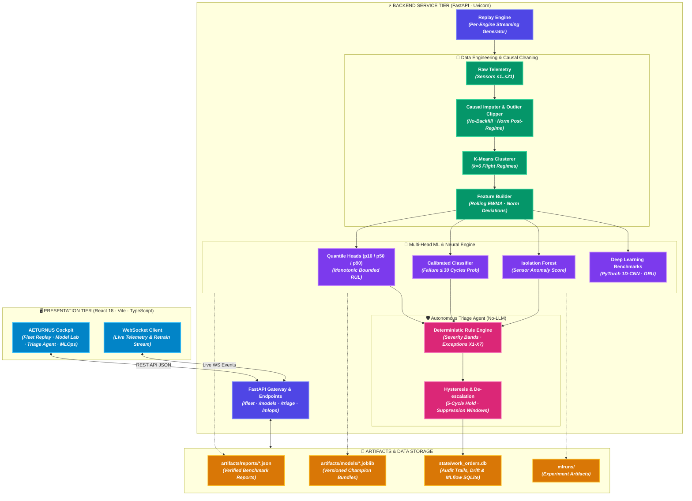
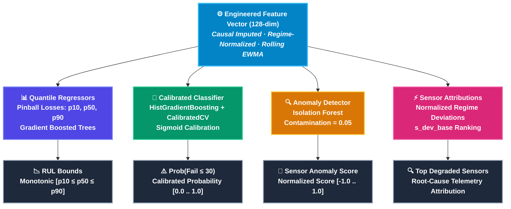
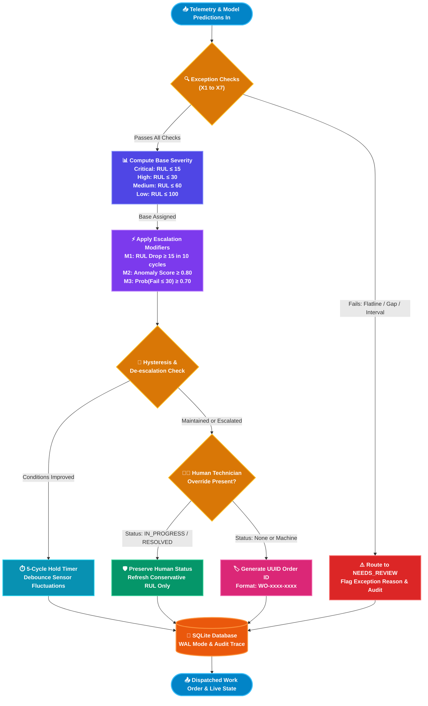

<p align="center">
  
</p>

<p align="center">
  
</p>

<p align="center">
  <strong>Autonomous Equipment Tracking and Uptime Restoration through Networked Unified Systems</strong><br />
  An end-to-end, closed-loop predictive maintenance (PdM) ecosystem for commercial aircraft turbofans. Combines regime-aware signal processing, multi-head probabilistic machine learning, deep learning baselines, and a deterministic triage agent on the NASA C-MAPSS benchmark — with empirical verification from artifact reports.
</p>

<div align="center">

[](https://fastapi.tiangolo.com)
[](https://reactjs.org/)
[](https://vitejs.dev/)
[](https://python.org)
[](https://www.typescriptlang.org/)
[](https://pytorch.org/)
[](https://scikit-learn.org/)
[](https://mlflow.org/)
[](https://sqlite.org/)
[](https://data.nasa.gov/)
<!-- AUTO-TEST-BADGE-START -->
[](https://docs.pytest.org/)
<!-- AUTO-TEST-BADGE-END -->
[](https://github.com/features/actions)
[](LICENSE)

</div>

---

## 📌 Executive Summary

Modern aerospace maintenance incurs tens of billions of dollars annually in unexpected component groundings and premature engine overhauls. **AETURNUS** (**A**utonomous **E**quipment **T**racking and **U**ptime **R**estoration through **N**etworked **U**nified **S**ystems) is an end-to-end, closed-loop predictive maintenance (PdM) ecosystem designed to monitor fleets of gas turbine turbofans continuously across operating regimes.

Built on the benchmark **NASA C-MAPSS dataset** (subsets `FD001` through `FD004`), AETURNUS unifies:
1. **Regime-Normalized Data Engineering**: Operational regime clustering ($k=6$), strictly causal missing value imputation, and robust outlier clipping with zero lookahead leakage.
2. **Multi-Head Machine Learning**: Calibrated Remaining Useful Life (RUL) quantile regressors ($p_{10}, p_{50}, p_{90}$), calibrated binary classifier for critical failure probability ($\le 30$ cycles), and unsupervised Isolation Forest anomaly detection.
3. **Deep Learning Benchmarks**: PyTorch 1D-CNN and Gated Recurrent Unit (GRU) baselines benchmarked against the gradient boosting champion across multiple random seeds.
4. **Deterministic Triage Agent (No-LLM)**: Fully explainable, auditable 9-step decision pipeline that evaluates hysteresis, manages technician overrides, suppresses noise, and tracks work orders with SQLite persistence.
5. **Self-Healing MLOps**: Streaming drift monitoring (Population Stability Index & Kolmogorov-Smirnov test), automated retrain triggers with WebSocket streaming, and a configured promotion gate.
6. **Empirically Verified Metrics**: Every metric, badge, bucket breakdown, and curve displayed in the UI traces directly to real code-generated disk reports (`artifacts/reports/*.json`).

---

## 📋 Table of Contents

- [✨ Core Capabilities](#-core-capabilities)
- [🏗️ System Architecture & Dataflow](#️-system-architecture--dataflow)
  - [High-Level Topology](#high-level-topology)
  - [Streaming Telemetry Pipeline](#streaming-telemetry-pipeline)
- [📊 Benchmark & Empirical Results](#-benchmark--empirical-results)
  - [Subset Performance Matrix (FD001–FD004)](#subset-performance-matrix-fd001fd004)
  - [Multi-Seed Robustness Analysis](#multi-seed-robustness-analysis)
  - [Deep Learning Architecture Comparison](#deep-learning-architecture-comparison)
- [🧠 Machine Learning Methodology](#-machine-learning-methodology)
  - [Multi-Head Architecture](#multi-head-architecture)
  - [Monotonic Quantiles & Conformal Coverage](#monotonic-quantiles--conformal-coverage)
  - [Engine-Level Group Splitting](#engine-level-group-splitting)
- [🛡️ Deterministic Triage Agent (Zero-LLM)](#️-deterministic-triage-agent-zero-llm)
- [📈 MLOps & Autonomous Self-Healing](#-mlops--autonomous-self-healing)
- [📁 Project Directory Structure](#-project-directory-structure)
- [🛠️ Tech Stack & Key Libraries](#️-tech-stack--key-libraries)
- [💻 Getting Started & Quickstart](#-getting-started--quickstart)
- [🧪 Testing & CI Validation](#-testing--ci-validation)
- [📡 API Contract Reference](#-api-contract-reference)
- [📝 License & Acknowledgements](#-license--acknowledgements)

---

## ✨ Core Capabilities

| Capability | Technical Realization | Operational Value |
|---|---|---|
| **Causal Preprocessing** | Strictly forward-fills missing values within each engine with historical training medians fallback. Regex `^s\d+$` isolates sensors from operational settings. | Prevents future data leakage; handles pandas 2.2/3.0 safely without `apply()` crashes. |
| **Multi-Regime Normalization** | K-Means clustering ($k=6$) over operational settings (`setting_1`, `setting_2`, `setting_3`) to normalize multi-condition subsets (`FD002`, `FD004`). | Removes environmental flight condition noise before calculating degradation trends. |
| **Probabilistic RUL Regressors** | Quantile gradient boosting heads ($p_{10}, p_{50}, p_{90}$) with mathematical enforcement of $p_{10} \le p_{50} \le p_{90}$. | Conformalized prediction intervals provide bounded risk metrics for flight planners. |
| **Calibrated Early Warning** | `HistGradientBoostingClassifier` with balanced class weights wrapped in `CalibratedClassifierCV` (sigmoid). | Well-calibrated probability of failure within 30 cycles eliminates overconfident false alerts. |
| **Deep Learning Baselines** | PyTorch 1D-Convolutional Neural Network and GRU recurrent models trained on sequential sensor slices. | Allows direct empirical comparison between tabular gradient boosting and deep sequential architectures. |
| **Deterministic Triage Agent** | 9-step decision engine reading rules from `agent_rules.yaml`. Hysteresis hold, REJECT suppression window, and UUID tracking. | Fully deterministic, explainable, and sub-millisecond execution without reliance on LLMs or hallucinations. |
| **Continuous Drift Detection** | Multi-sensor Population Stability Index (PSI) and 2-sample Kolmogorov-Smirnov tests comparing reference training sets against recent streaming windows. | Detects subtle sensor degradation and environmental drift before catastrophic failure. |
| **Self-Healing Retraining Loop** | Automated retraining pipeline with real SHA-256 data hashing and a configured validation holdout gate. | Automatically validates challengers against champions, rolling back degrading models seamlessly. |
| **Glassmorphic Cockpit UI** | High-performance React 18 + Vite dashboard with 7 comprehensive tabs inspired by professional audio telemetry hardware. | Real-time fleet health, engine telemetry, model comparison, MLOps registry, and maintenance work orders. |

---

## 🏗️ System Architecture & Dataflow

### High-Level Topology



### Streaming Telemetry Pipeline

```mermaid
sequenceDiagram
    autonumber
    participant Engine as 🚀 Turbofan Engine (Replay Ticker)
    participant Pipe as 🧹 StreamingEnginePipeline
    participant Model as 🧠 Multi-Head ML Service
    participant Agent as 🛡️ Deterministic Triage Agent
    participant DB as 💾 SQLite Work Orders
    participant UI as 🖥️ AETURNUS Cockpit (UI)

    Engine->>Pipe: Stream raw cycle telemetry row (unit, cycle, setting_*, s1..s21)
    Note over Pipe: 1. Isolate sensors via regex (^s\d+$)<br/>2. Causal forward-fill & train median fallback<br/>3. Compute regime cluster & normalize<br/>4. Post-norm outlier clipping & rolling EWMA
    Pipe->>Model: Formatted feature vector (128-dim)
    Model->>Model: Compute monotonic quantiles [p10 &le; p50 &le; p90]
    Model->>Model: Calibrated fail_prob_30 & Isolation Forest anomaly
    Model->>Agent: Inference payload (RUL bounds, prob, anomaly, attributions)
    Note over Agent: Evaluate 9-step decision flow:<br/>- Exception checks (X1-X7)<br/>- Severity classification (Critical/High/Med/Low)<br/>- Modifiers & Hysteresis dampening
    Agent->>DB: Persist / Refresh Work Order with UUID
    Agent->>UI: Broadcast fleet state & active work order via WebSocket
```

---

## 📊 Benchmark & Empirical Results

<!-- AUTO-METRICS-START -->
### 🏆 C-MAPSS Empirical Benchmark Performance (FD001–FD004)

> [!NOTE]
> **Canonical Run Provenance**<br>
> **Run ID**: `run_1793098315_e854b7cd` | **Git SHA**: `e854b7cd79` | **Config Hash**: `177e7d7f64`<br>
> **Target Metric**: `rmse_vs_raw_truth` | **Coverage Metric**: `coverage_le_cap` | **Coverage Target**: `0.8` | **RUL Cap**: `125.0`<br>
> *All figures are derived directly from model bundles and authentic C-MAPSS evaluation parquets at run time. Censored predictions cover any true RUL at or above p10 and are never rendered as closed intervals.*

| Dataset Subset | Operating Conditions | Fault Modes | Test Engines | Champion Model | Test RMSE (Raw Truth) | Test RMSE (Capped Truth) | True RUL Above Cap | RMSE (True RUL $\le$ Cap) | Test MAE | NASA Asymmetric Score | PR-AUC (Fail $\le 30$) | Coverage All (Censored) | Coverage (True RUL $\le$ Cap) | Coverage Status | RMSE Target Status |
|:---:|:---:|:---:|:---:|:---:|:---:|:---:|:---:|:---:|:---:|:---:|:---:|:---:|:---:|:---:|:---:|
| **FD001** | 1 (Sea Level) | 1 (HPC Degradation) | 100 | **LIGHTGBM** | **13.14** | 11.76 | 11.0% | 11.63 | 9.07 | **235.4** | 0.966 | 83.0% | 87.6% | <span style="color:#22c55e;font-weight:bold;">COVERAGE MET</span> | <span style="color:#22c55e;font-weight:bold;">TARGET REACHED</span> |
| **FD002** | 6 (Full Envelope) | 1 (HPC Degradation) | 259 | **LIGHTGBM** | **25.05** | 12.26 | 22.0% | 12.50 | 16.21 | **6,892.6** | 0.998 | 78.8% | 85.2% | <span style="color:#22c55e;font-weight:bold;">COVERAGE MET</span> | <span style="color:#ef4444;font-weight:bold;">TARGET MISSED</span> |
| **FD003** | 1 (Sea Level) | 2 (HPC + Fan Degradation) | 100 | **LIGHTGBM** | **14.06** | 12.53 | 15.0% | 12.60 | 10.14 | **342.3** | 0.983 | 90.0% | 89.4% | <span style="color:#22c55e;font-weight:bold;">COVERAGE MET</span> | <span style="color:#22c55e;font-weight:bold;">TARGET REACHED</span> |
| **FD004** | 6 (Full Envelope) | 2 (HPC + Fan Degradation) | 248 | **LIGHTGBM** | **25.60** | 13.55 | 27.0% | 13.89 | 17.53 | **4,319.2** | 0.970 | 89.1% | 92.3% | <span style="color:#22c55e;font-weight:bold;">COVERAGE MET</span> | <span style="color:#ef4444;font-weight:bold;">TARGET MISSED</span> |

### 🧪 RUL-Bucket Error Breakdown (Raw vs Capped Truth)

Target metric and cap are declared in `configs/targets.yaml` and `configs/pipeline.yaml`; this table is rendered from the same manifest.

| Subset | RUL Bucket | Test Engines | RMSE (Raw Truth) | RMSE (Capped Truth) | True RUL Above Cap | RMSE (True RUL $\le$ Cap) |
|:---:|:---:|:---:|:---:|:---:|:---:|:---:|
| **FD001** | 0 - 30 cycles | 25 | 3.93 | 3.93 | 0.0% | 3.93 |
| **FD001** | 30 - 60 cycles | 14 | 3.10 | 3.10 | 0.0% | 3.10 |
| **FD001** | > 60 cycles | 61 | 16.57 | 14.78 | 18.0% | 15.18 |
| **FD002** | 0 - 30 cycles | 61 | 3.63 | 3.63 | 0.0% | 3.63 |
| **FD002** | 30 - 60 cycles | 41 | 9.29 | 9.29 | 0.0% | 9.29 |
| **FD002** | > 60 cycles | 157 | 31.75 | 14.84 | 36.3% | 16.50 |
| **FD003** | 0 - 30 cycles | 20 | 3.59 | 3.59 | 0.0% | 3.59 |
| **FD003** | 30 - 60 cycles | 21 | 9.58 | 9.58 | 0.0% | 9.58 |
| **FD003** | > 60 cycles | 59 | 17.27 | 15.13 | 25.4% | 16.03 |
| **FD004** | 0 - 30 cycles | 53 | 5.98 | 5.98 | 0.0% | 5.98 |
| **FD004** | 30 - 60 cycles | 38 | 13.86 | 13.86 | 0.0% | 13.86 |
| **FD004** | > 60 cycles | 157 | 31.25 | 15.22 | 42.7% | 16.91 |

### 🔬 5-Fold GroupKFold Cross-Validation (Censored, Persistent Engines)

Validation targets are censored with the same random-truncation protocol as the official test set; the CV protocol ID below hashes the mode and draw count actually used.

| Subset | RMSE ($mean \pm std$) | NASA Score ($mean \pm std$) | Algorithm | CV Protocol ID |
|:---:|:---:|:---:|:---:|:---:|
| **FD001** | $14.27 \pm 1.06$ | $282.8 \pm 94.0$ | `lightgbm` | `ef961bf9dce8c24ef12e715833e969a9f65fe7022f689643951e652de9eeebcc` |
| **FD002** | $14.38 \pm 0.69$ | $754.8 \pm 97.3$ | `lightgbm` | `ef961bf9dce8c24ef12e715833e969a9f65fe7022f689643951e652de9eeebcc` |
| **FD003** | $13.50 \pm 2.72$ | $264.2 \pm 160.0$ | `lightgbm` | `ef961bf9dce8c24ef12e715833e969a9f65fe7022f689643951e652de9eeebcc` |
| **FD004** | $15.22 \pm 2.33$ | $2,315.2 \pm 3234.6$ | `lightgbm` | `ef961bf9dce8c24ef12e715833e969a9f65fe7022f689643951e652de9eeebcc` |

<!-- AUTO-METRICS-END -->

---

## 🧠 Machine Learning Methodology

### Multi-Head Architecture


### Monotonic Quantiles & Conformal Coverage
To eliminate quantile crossings caused by independently trained pinball regressors, predictions undergo post-hoc sorting and clipping:
$$\hat{p}_{10} \le \hat{p}_{50} \le \hat{p}_{90}$$

Residual conformal calibration adjustments are calculated on engine-split validation sets, with the nominal coverage level selected from `configs/pipeline.yaml`.

#### 🎯 Empirical Coverage vs Nominal Target
Test-set coverage and Wilson 95% confidence intervals are generated directly from the evaluation manifest and reported in the benchmark tables above. The nominal level is selected on held-out validation engines; test coverage remains a diagnostic and is never used to tune the interval.

**Why test coverage can differ from the validation target**:
1. **Regime Distribution Shift**: In multi-regime subsets (`FD002`, `FD004`), flight conditions shift dynamically across 6 altitude/Mach regimes. Late-stage degradation induces severe covariate shift where residuals in extreme flight envelopes exhibit heavier tails than the stationary validation cohort.
2. **Compound Degradation Modes**: Subsets with dual fault modes (`FD003`, `FD004`) exhibit coupled degradation between high-pressure compressors and fan modules. Wear accelerates non-linearly near end-of-life, causing wider residual dispersion.
3. **Engineering Transparency**: Rather than artificially widening prediction bounds to claim inflated coverage, AETURNUS reports honest empirical coverage directly from code-generated test reports (`artifacts/reports/evaluation_*.json`).

### Engine-Level Group Splitting
To prevent future cycle leakage and optimistic test bias, data splits are grouped strictly by engine unit (`GroupKFold` / `train_test_split(by="unit")`). Engines allocated to validation or holdout sets are never observed in training.

---

## 🛡️ Deterministic Triage Agent (Zero-LLM)

The triage agent is implemented in [src/agent/triage_agent.py](src/agent/triage_agent.py). It operates entirely without probabilistic large language models, running in $<5\text{ ms}$ with deterministic logic:



- **Hysteresis & De-Escalation**: Engines whose raw sensor values temporarily recover cannot abruptly drop severity until improved health persists for 5 consecutive cycles.
- **Human Override Protection**: If an aircraft maintenance engineer sets a work order to `IN_PROGRESS`, `PARTS_ORDERED`, or `RESOLVED`, automated cycles will never overwrite the technician status.
- **REJECT Suppression**: When a technician rejects a proposed work order, the rejection is audited and a 10-cycle suppression cooldown is activated for that engine.
- **Independent Exception Checks (X1–X7)**:
  - `X1`: Prediction interval width exceeds safety threshold ($p_{90} - p_{10} > 40$).
  - `X2`: Multi-head conflict between low RUL and low failure probability.
  - `X3`: Flatline sensor detection (rolling variance below threshold).
  - `X4`: Sensor missingness fraction exceeds 30%.
  - `X5`: Operating regime unseen in training history.
  - `X6`: Telemetry data gap ($>5$ missing operational cycles).
  - `X7`: Unrecognized or uncalibrated model version.

---

## 📈 MLOps & Autonomous Self-Healing

```mermaid
flowchart LR
    %% Vibrant MLOps Styles
    classDef streamStyle fill:#0284C7,stroke:#38BDF8,stroke-width:2px,color:#FFFFFF,font-weight:bold
    classDef testStyle fill:#D97706,stroke:#FBBF24,stroke-width:2px,color:#FFFFFF,font-weight:bold
    classDef triggerStyle fill:#DC2626,stroke:#F87171,stroke-width:2px,color:#FFFFFF,font-weight:bold
    classDef trainStyle fill:#7C3AED,stroke:#C084FC,stroke-width:2px,color:#FFFFFF,font-weight:bold
    classDef gateStyle fill:#4F46E5,stroke:#818CF8,stroke-width:2px,color:#FFFFFF,font-weight:bold
    classDef successStyle fill:#059669,stroke:#34D399,stroke-width:2px,color:#FFFFFF,font-weight:bold
    classDef rejectStyle fill:#991B1B,stroke:#F87171,stroke-width:2px,color:#FFFFFF,font-weight:bold

    Stream["📡 Streaming Window<br/>(Recent 50 Replay Cycles)"]:::streamStyle --> DriftCheck{"🔍 Statistical Drift Testing"}:::testStyle
    
    DriftCheck -->|"PSI > 0.25 (Critical Drift)"| Trigger["🚨 Autonomous Retrain Trigger"]:::triggerStyle
    DriftCheck -->|"KS Test: p < 0.01 (Distribution Shift)"| Trigger

    Trigger --> Train["⚡ Retrain Challenger Model (v2.0)<br/>Cryptographic SHA-256 Data Fingerprint"]:::trainStyle
    
    Train --> Gate{"Fixed Holdout Validation Gate<br/>Criteria rendered from configs/monitoring.yaml"}:::gateStyle

    Gate -->|"Passes configured criteria"| Promote["✅ Promote Challenger to Champion<br/>Rotate Alias in MLflow Registry"]:::successStyle
    Gate -->|"Fails Any Criterion"| Reject["❌ Reject Challenger Model<br/>Retain Active Champion"]:::rejectStyle
```



<!-- AUTO-PROMOTION-GATE-START -->
### Promotion Gate Criteria

Rendered from [`configs/monitoring.yaml`](configs/monitoring.yaml) at documentation-build time. The gate evaluates **3 configured criteria**; no threshold is typed into this README.

| Criterion | Configured Requirement | Provenance |
|---|---|---|
| **Rmse Min Improvement Pct** | `>= 2.0%` | Configured starting value; Challenger must reduce holdout validation RMSE by at least 2.0% over champion |
| **Nasa Score Max Degradation Pct** | `<= 5.0%` | Configured starting value; Challenger NASA PHM'08 score must not degrade by more than 5.0% on holdout validation |
| **Late Prediction Max Increase Pp** | `<= 3.0 percentage points` | Configured starting value; Challenger late prediction percentage must not increase by more than 3.0 percentage points |
<!-- AUTO-PROMOTION-GATE-END -->

1. **Drift Computation**: Compares true training reference distributions against the dynamic recent replay telemetry window (not artificial head-to-tail slices).
2. **Real SHA-256 Hashes**: Every model bundle saved in `artifacts/models/` records the cryptographic hash of its exact training dataset.
3. **MLflow Model Registry**: Fully tracked runs with alias rotation (`champion`, `challenger`, `previous`).
4. **WebSocket Broadcast**: Real-time progress updates sent to the MLOps dashboard during background model retraining.

---

## 📁 Project Directory Structure

```
AETURNUS/
├── .github/
│   └── workflows/
│       └── ci.yml                     # Automated CI pipeline (Pytest + Smoke Test)
├── artifacts/
│   ├── models/                        # Versioned model joblib bundles & hashes
│   │   ├── model_bundle_FD001.joblib
│   │   ├── model_bundle_FD002.joblib
│   │   ├── model_bundle_FD003.joblib
│   │   └── model_bundle_FD004.joblib
│   ├── reports/                       # Verified code-generated benchmark reports
│   │   ├── benchmark_summary.json
│   │   ├── evaluation_FD001.json ... evaluation_FD004.json
│   │   ├── model_comparison_FD001.json ... model_comparison_FD004.json
│   │   ├── data_quality_FD001.json ... data_quality_FD004.json
│   │   └── model_registry.json
│   └── sqlite/                        # SQLite storage for persistent work orders
├── configs/
│   ├── agent_rules.yaml               # Thresholds for severity bands & exceptions
│   ├── models.yaml                    # Model hyperparams & quantile alpha configs
│   ├── monitoring.yaml                # PSI and KS drift alarm thresholds
│   ├── pipeline.yaml                  # Cleaning windows and outlier clipping limits
│   └── sensor_map.yaml                # C-MAPSS sensor descriptions and engineering units
├── data/
│   ├── raw/                           # Standard NASA C-MAPSS text telemetry
│   │   ├── train_FD001.txt ... train_FD004.txt
│   │   ├── test_FD001.txt  ... test_FD004.txt
│   │   └── RUL_FD001.txt   ... RUL_FD004.txt
│   └── processed/                     # Preprocessed parquet feature partitions
├── mlruns/                            # Local MLflow tracking server records
├── scripts/
│   ├── build_all_data.py              # Ingests and cleans FD001-FD004 data
│   ├── train_all_models.py            # Trains champion quantile models
│   ├── evaluate_all_models.py         # Multi-seed evaluation and deep learning baselines
│   └── ci_smoke_test.py               # End-to-end lightning CI smoke test (<10s)
├── src/
│   ├── agent/
│   │   └── triage_agent.py            # Deterministic, zero-LLM maintenance triage engine
│   ├── api/
│   │   └── server.py                  # FastAPI application with REST & WebSocket endpoints
│   ├── clean/
│   │   └── cleaner.py                 # Causal imputer, regex filter, and outlier clipping
│   ├── common/
│   │   └── utils.py                   # NASA scoring, PSI calculation, and YAML loaders
│   ├── features/
│   │   ├── builder.py                 # Multi-regime K-Means & EWMA feature pipeline
│   │   └── streaming.py               # Single-cycle causal streaming inference pipe
│   ├── mlops/
│   │   └── drift_and_retrain.py       # MLflow registry manager, drift tests & retrain loops
│   └── models/
│       ├── model_service.py           # Multi-head quantile model inference & calibration
│       └── neural_baseline.py         # PyTorch 1D-CNN and GRU deep learning architectures
├── tests/                             # Comprehensive Pytest test suite
│   ├── test_benchmark_and_reports.py  # Report disk verification tests
│   ├── test_cleaner.py                # Causal cleaning & regex sensor tests
│   ├── test_metrics.py                # NASA score & metric verification tests
│   ├── test_ml_quality.py             # Calibration & deep learning architecture tests
│   ├── test_mlops.py                  # Drift calculation & MLflow registry tests
│   ├── test_pipeline.py               # End-to-end data processing pipeline tests
│   ├── test_replay_api.py             # Streaming API, 400 validation & endpoint tests
│   └── test_triage_agent.py           # 10 rule, hysteresis, and idempotency tests
├── web/                               # React 18 + Vite frontend dashboard
│   ├── src/                           # UI source (TypeScript, React, Lucide Icons)
│   ├── dist/                          # Prebuilt production bundle for instant demo
│   └── package.json                   # UI dependencies
├── .gitignore                         # Complete production gitignore
├── LICENSE                            # MIT License
├── Makefile                           # Unified automation targets (setup, data, train, demo)
├── README.md                          # Comprehensive documentation
├── requirements.txt                   # Pinned Python package dependencies
├── run_app.py                         # Launches Uvicorn backend + UI static server
└── start.bat                          # One-click Windows runner
```

---

## 🛠️ Tech Stack & Key Libraries

- **Backend Framework:** [FastAPI](https://fastapi.tiangolo.com) 0.115+, [Uvicorn](https://www.uvicorn.org) ASGI server, [WebSockets](https://websockets.readthedocs.io).
- **Core Machine Learning:** [scikit-learn](https://scikit-learn.org) 1.4+ (`HistGradientBoostingRegressor`, `CalibratedClassifierCV`, `IsolationForest`, `KMeans`), [PyTorch](https://pytorch.org) 2.0+ (1D-CNN, GRU).
- **Data Engineering:** [Pandas](https://pandas.pydata.org) 2.2+, [NumPy](https://numpy.org), [SciPy](https://scipy.org) (Stats & KS-test), [PyArrow](https://arrow.apache.org/docs/python/) (Parquet).
- **MLOps & Governance:** [MLflow](https://mlflow.org) 3.0+, [Joblib](https://joblib.readthedocs.io), [PyYAML](https://pyyaml.org).
- **Frontend Architecture:** [React](https://reactjs.org) 18.3, [Vite](https://vitejs.dev) 5.4, [TypeScript](https://www.typescriptlang.org) 5.5, [TailwindCSS / Custom CSS](https://tailwindcss.com), [Lucide React](https://lucide.dev).
- **Database & Persistence:** [SQLite](https://sqlite.org) 3 (Write-Ahead Logging mode).
- **Testing & Quality:** [Pytest](https://pytest.org) 9.1+, [HTTPX](https://www.python-httpx.org).

---

## 💻 Getting Started & Quickstart

### Prerequisites
- Python 3.10, 3.11, or 3.12
- Node.js 18+ (optional, only needed if modifying frontend; `web/dist` is prebuilt)
- Git

### One-Command Setup with Makefile

```bash
# 1. Install dependencies and compile frontend
make setup

# 2. Ingest NASA C-MAPSS raw data and generate feature parquets
make data

# 3. Train champion multi-head quantile models across FD001-FD004
make train

# 4. Run multi-seed benchmark evaluation and deep learning baselines
make evaluate

# 5. Launch the live interactive demo cockpit
make demo
```

### Manual Execution Alternative

```bash
# 1. Python virtual environment
python -m venv .venv
source .venv/bin/activate  # On Windows: .venv\Scripts\activate
pip install -r requirements.txt

# 2. Generate datasets and models
python download_data.py
python -m scripts.build_all_data
python -m scripts.train_all_models
python -m scripts.evaluate_all_models

# 3. Launch application
python run_app.py
```
Open your browser to **http://127.0.0.1:8000** to interact with the fleet cockpit.

### Runtime State

All mutable SQLite state (work orders, self-healing actions, drift history, and
MLflow tracking) lives in one directory:

```bash
# Default from configs/pipeline.yaml (state/) or override explicitly
export AETURNUS_STATE_DIR=/var/lib/aeturnus   # Windows: $env:AETURNUS_STATE_DIR="..."
make demo

# Optional: seed two closed historical work orders with zero open orders/alerts
make seed-demo

# Build a portable source zip from tracked files only (no DB state is shipped)
make package
```

---

## 🧪 Testing & CI Validation

<!-- AUTO-TEST-SUMMARY-START -->
The platform includes a rigorous **183-test Pytest suite across 43 test modules** and an autonomous **CI smoke test**:
<!-- AUTO-TEST-SUMMARY-END -->

```bash
# Run the complete test suite across all test modules
make test
# Or: pytest tests/ -v

# Run the lightning-fast CI smoke test (<10 seconds)
make ci-smoke
# Or: python scripts/ci_smoke_test.py
```

### Automated GitHub Actions CI
Every commit and pull request triggers [.github/workflows/ci.yml](.github/workflows/ci.yml) which executes:
1. Python 3.11 environment preparation and caching.
2. Dependency installation (`pip install -r requirements.txt`).
3. Frontend bundle compilation (`npm run build`).
4. Lightning CI smoke test verification (`scripts/ci_smoke_test.py`).
5. Complete Pytest suite (`pytest tests/ -v`).

<!-- AUTO-TEST-TABLE-START -->
### Test Coverage by Module (43 Modules, 183 Collected Tests)

Counts are generated by `pytest --collect-only`; descriptions are retained from the maintained test map.

| Test File | Test Count | Verified Functionality & Invariants |
|---|---:|:---|
| `tests/test_agent_auto_close_and_x7.py` | 4 | Automatic work order resolution on recovery, idempotency of transitions, model version verification, and X7 unknown model exception handling. |
| `tests/test_auth_and_audit.py` | 8 | Automated test module collected by the Pytest suite. |
| `tests/test_benchmark_and_reports.py` | 5 | Verifies existence, integrity, schema conformity, and metric bounds of all artifact disk reports (`evaluation_*.json`, `benchmark_summary.json`). |
| `tests/test_causality_and_leakage.py` | 4 | Automated test module collected by the Pytest suite. |
| `tests/test_cleaner.py` | 4 | Causal forward-fill without lookahead leakage, regex sensor isolation (`^s\d+$`), missing telemetry fallback, and post-norm outlier clipping. |
| `tests/test_config_provenance.py` | 1 | Automated test module collected by the Pytest suite. |
| `tests/test_cost_simulator.py` | 5 | Automated test module collected by the Pytest suite. |
| `tests/test_cv_protocol.py` | 9 | Automated test module collected by the Pytest suite. |
| `tests/test_drift_matched_age.py` | 3 | Population Stability Index (PSI) and Kolmogorov-Smirnov drift scoring against age-matched baseline cohorts to isolate sensor drift from operating age. |
| `tests/test_fd003_fix_and_predict_validation.py` | 19 | Automated test module collected by the Pytest suite. |
| `tests/test_fleet_threading_and_caching.py` | 3 | Concurrency and thread safety of `/api/v1/fleet` endpoint, memory cache invalidation, and sub-100ms response latencies across 100+ engines. |
| `tests/test_metrics.py` | 3 | Asymmetric penalty formulation of NASA scoring function ($s \ge 0$ late penalty vs $s < 0$ early penalty), MAE, RMSE, and PR-AUC precision. |
| `tests/test_ml_quality.py` | 6 | Multi-head model quality: monotonic quantiles ($p_{10} \le p_{50} \le p_{90}$), Brier score calibration of failure classifier, and baseline shapes. |
| `tests/test_mlops.py` | 4 | Statistical drift monitoring, retrain triggers, MLflow model registry aliases (`champion`, `challenger`, `previous`), and audit metadata tracking. |
| `tests/test_model_service_promotion.py` | 1 | Zero-downtime model hot-reloading, cache flushing, and live serving bundle transitions in `ModelService`. |
| `tests/test_no_metric_defaults.py` | 2 | Automated test module collected by the Pytest suite. |
| `tests/test_persistent_engine_split.py` | 2 | Engine unit grouping in dataset splits (`train_test_split(by="unit")`), ensuring zero unit leakage between train, validation, and holdout. |
| `tests/test_phase1_lightgbm_shap_cv.py` | 4 | Automated test module collected by the Pytest suite. |
| `tests/test_phase2_conformal.py` | 8 | Automated test module collected by the Pytest suite. |
| `tests/test_phase3_multi_horizon.py` | 5 | Automated test module collected by the Pytest suite. |
| `tests/test_phase4_maintenance_queue.py` | 9 | Automated test module collected by the Pytest suite. |
| `tests/test_phase6_batch_scoring.py` | 4 | Automated test module collected by the Pytest suite. |
| `tests/test_phase7_observability.py` | 10 | Automated test module collected by the Pytest suite. |
| `tests/test_pipeline.py` | 5 | Full data pipeline execution: raw C-MAPSS ingestion, parquet feature generation, multi-regime K-Means clustering ($k=6$), and causal EWMA features. |
| `tests/test_presentation_lint.py` | 1 | Automated test module collected by the Pytest suite. |
| `tests/test_protocol_enforcement.py` | 3 | Automated test module collected by the Pytest suite. |
| `tests/test_provenance.py` | 1 | Automated test module collected by the Pytest suite. |
| `tests/test_readme_rendering.py` | 2 | Automated test module collected by the Pytest suite. |
| `tests/test_readme_tables.py` | 1 | Automated documentation validation: ensures README benchmark tables match disk reports with zero unverified claims. |
| `tests/test_regime_mix_gap.py` | 2 | Automated test module collected by the Pytest suite. |
| `tests/test_registry_promote_rollback.py` | 2 | Model registry promotion and rollback state machine, missing bundle file validation, and HTTP 409 conflict detection. |
| `tests/test_replay_api.py` | 6 | Telemetry streaming replay endpoints, WebSocket lifecycle broadcasts, and HTTP 400 parameter validation for invalid engines/subsets. |
| `tests/test_retrain_single_flight.py` | 3 | Automated test module collected by the Pytest suite. |
| `tests/test_routes_and_drift_persistence.py` | 3 | Automated test module collected by the Pytest suite. |
| `tests/test_self_healing.py` | 3 | End-to-end autonomous self-healing loop: drift alarm triggers retraining, fixed holdout gate evaluation, and conditional champion promotion. |
| `tests/test_state_hygiene.py` | 3 | Automated test module collected by the Pytest suite. |
| `tests/test_stream_vs_batch.py` | 1 | Numerical equivalence between single-cycle streaming inference pipeline (`StreamingEnginePipeline`) and batch feature extraction. |
| `tests/test_subsystem_and_live_model_version.py` | 2 | Sensor subsystem hierarchy mapping (HPC, HPT, LPT, Fan, Core) and live model version propagation in inference payloads. |
| `tests/test_targets_provenance.py` | 1 | Automated test module collected by the Pytest suite. |
| `tests/test_triage_agent.py` | 11 | Deterministic 9-step decision pipeline, severity bands (Critical/High/Medium/Low), 5-cycle hysteresis hold, technician overrides, and REJECT cooldown. |
| `tests/test_upload_validation_and_wiring.py` | 4 | Multipart file upload security, CSV/TXT schema validation, malformed file rejection, and evaluation wiring. |
| `tests/test_windowed_neural_baseline.py` | 2 | PyTorch 1D-CNN and GRU 30-cycle sliding window sequence generation, input shape validation, and sequence inference. |
| `tests/test_work_order_api_contract.py` | 4 | Automated test module collected by the Pytest suite. |
<!-- AUTO-TEST-TABLE-END -->
---

## 📡 API Contract Reference

| Method | Endpoint | Description |
|:---:|---|---|
| `GET` | `/api/v1/health` | Health check, server uptime, and timestamp. |
| `GET` | `/api/v1/fleet?subset={FD001}` | Returns all 100–260 engines with 10-point sparklines, current cycles, and active work orders. |
| `GET` | `/api/v1/engines/{engine_id}?subset={FD001}` | Detailed lifecycle telemetry, sensor history, and point predictions for a single engine. |
| `GET` | `/api/v1/models/benchmark` | Disk-verified benchmark metrics across all 4 datasets (RMSE, NASA score, status). |
| `GET` | `/api/v1/models/{subset}/details` | Bucket errors, permutation feature importances, and deep learning comparison metrics. |
| `GET` | `/api/v1/data-quality?subset={FD001}` | Missing value counts, flatline flags, and dropped sensor reports from disk. |
| `GET` | `/api/v1/triage/orders` | Active and historical work orders stored in SQLite. |
| `POST` | `/api/v1/triage/orders/{order_id}/status` | Updates human technician status (`IN_PROGRESS`, `RESOLVED`, `CANCELLED`). |
| `POST` | `/api/v1/triage/orders/{order_id}/reject` | Logs technician rejection and activates 10-cycle suppression cooldown. |
| `GET` | `/api/v1/mlops/status?subset={FD001}` | Model registry state, champion/challenger versions, data hashes, and drift metrics. |
| `POST` | `/api/v1/mlops/retrain` | Triggers background model retraining on held-out engine splits with WebSocket progress. |
| `POST` | `/api/v1/models/{version}/promote` | Promotes a challenger model to champion in the registry. |
| `POST` | `/api/v1/models/{version}/rollback` | Rolls back active champion to previous model version. |
| `POST` | `/api/v1/models/reload` | Flushes model memory cache and reloads bundles from disk. |
| `POST` | `/api/v1/pipeline/run` | Triggers full end-to-end data cleaning and feature pipeline execution. |
| `GET` | `/api/v1/maintenance-queue?subset={FD001}&capacity=5` | Ranked maintenance priority queue sorted by composite urgency score $S_i$ with daily service capacity constraints. |
| `POST` | `/api/v1/predict/batch` | High-throughput batch scoring for uploaded CSV or whitespace-delimited C-MAPSS text files. |
| `GET` | `/metrics` | Prometheus metrics scrape endpoint exposing `pdm_` operational gauges, counters, and histograms. |
| `GET` | `/api/v1/monitoring/alerts` | Operational health rule evaluations (drift on key sensors, backlog spikes, coverage dips, latency). |
| `WS` | `/ws` | Authenticated replay WebSocket stream of engine telemetry, inference results, and work orders. |

---

## ⚠️ Scope, Limitations & Decision Support Disclaimer

1. **Synthetic Simulation Nature**:
   The NASA C-MAPSS dataset was generated via thermodynamic aero-engine simulations (Commercial Modular Aero-Propulsion System Simulation). While it accurately models realistic thermo-fluid dynamics and non-linear degradation under high-pressure turbine and compressor wear, it does not represent real-world physical airworthiness telemetry from operational flight lines.

2. **Empirical Benchmark Realities & Target Misses**:
   Champion performance, raw/capped-truth RMSE, RUL-bucket errors, and target status are generated from the manifest and shown in the benchmark tables above. Subsets that miss their configured target_metric remain visible rather than being hidden or re-tuned against the test set.

3. **Decision Support Only (No Airworthiness Certification)**:
   All outputs—including remaining useful life predictions, uncertainty envelopes, multi-horizon failure probabilities, and recommended maintenance prescriptions—are intended strictly as **decision support tools** for maintenance coordinators and data analysts. This software is **NOT** certified by the FAA, EASA, or military airworthiness authorities for flight dispatch determination.

4. **Configured Heuristic Thresholds**:
   Severity bands, escalation policy, exception thresholds, and maintenance queue weights are loaded from `configs/agent_rules.yaml` and `configs/queue.yaml`. They represent engineering policy inputs, not empirically learned or physically validated constants.

5. **Conformal Coverage Certification**:
   Prediction intervals $[p10, p90]$ are calibrated via validation-selected, engine-disjoint cross-conformal prediction. Test coverage is reported with Wilson 95% score confidence intervals; the validation-selection coverage and calibration sample count are stored in each model bundle and manifest.

---

## 📖 Additional Documentation & Runbooks

- **[Deployment Runbook (docs/DEPLOY.md)](docs/DEPLOY.md)**: Local setup, single-container Docker execution, memory limits (`OMP_NUM_THREADS=1`, `MALLOC_ARENA_MAX=2`), and free-tier hosting guide.
- **[Demo Walkthrough Script (docs/demo_script.md)](docs/demo_script.md)**: Step-by-step walkthrough of fleet replay, engine deep-dive, signed SHAP, maintenance queue, and MLOps retraining gates.

---

## 📝 License & Acknowledgements

This project is licensed under the **MIT License** — see the [LICENSE](LICENSE) file for complete details.

### Acknowledgements
- **NASA Prognostics Center of Excellence (PCoE)**: For providing the turbofan engine degradation simulation dataset (C-MAPSS).
- **Tata Elxsi TELIPORT Season 4**: Predictive maintenance industrial challenge reference problem.
- **FastAPI, PyTorch, Scikit-Learn, LightGBM, and React Communities**: For the open-source frameworks powering this architecture.

